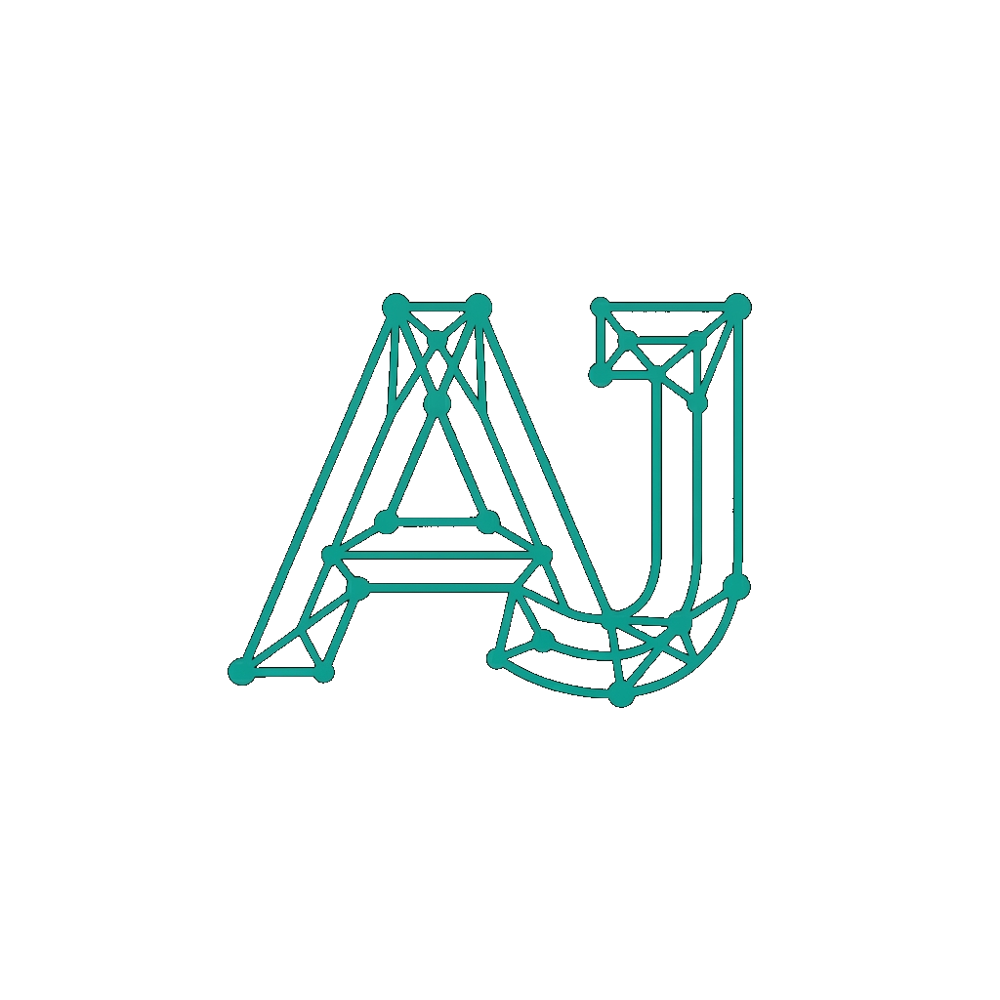

  

  
   
  
   
  
  
  
  
    
  

## About

Fourth-year AI student at Jordan University of Science & Technology (JUST). I build practical AI systems from model development through deployment, with a focus on computer vision, MLOps and Arabic NLP. I prefer local-first AI: no API dependency, full control of the pipeline.

## Featured Projects

<table>
  <tr>
    <td width="50%" valign="top">
      <h3><a href="https://github.com/DRAGOX7/aaos">AAOS — Academic AI OS</a></h3>
      <b>Local-first academic assistant for Moodle</b> 
      English and Arabic answers with cited course sources, hybrid retrieval and claim verification. Read-only Moodle sync, study tasks, approval-gated Calendar actions and Telegram alerts.  
      <code>Python</code> <code>FastAPI</code> <code>RAG</code> <code>Next.js</code>
    </td>
    <td width="50%" valign="top">
      <h3><a href="https://github.com/DRAGOX7/Anti_uav_detection">Anti-UAV Detection &amp; Tracking</a></h3>
      <b>Computer vision for drone detection and tracking</b> 
      YOLOv11-S and RT-DETR-R50 with ByteTrack for RGB images and video. MLflow experiment tracking, a Streamlit interface and a Docker-based pipeline.  
      <code>PyTorch</code> <code>YOLOv11</code> <code>ByteTrack</code> <code>MLflow</code> <code>Docker</code>
    </td>
  </tr>
</table>

## Skills

**`// AI & Deep Learning`**

**`// MLOps & Infrastructure`**

**`// Full-Stack Web`**

**`// Tooling`**

## GitHub Statistics

  

  

  

## Contact

Open to internships and collaborations.

